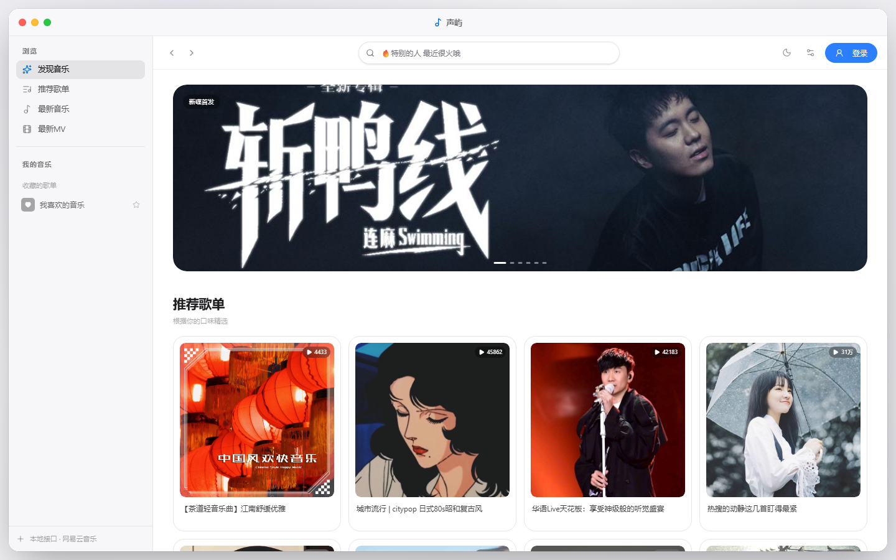
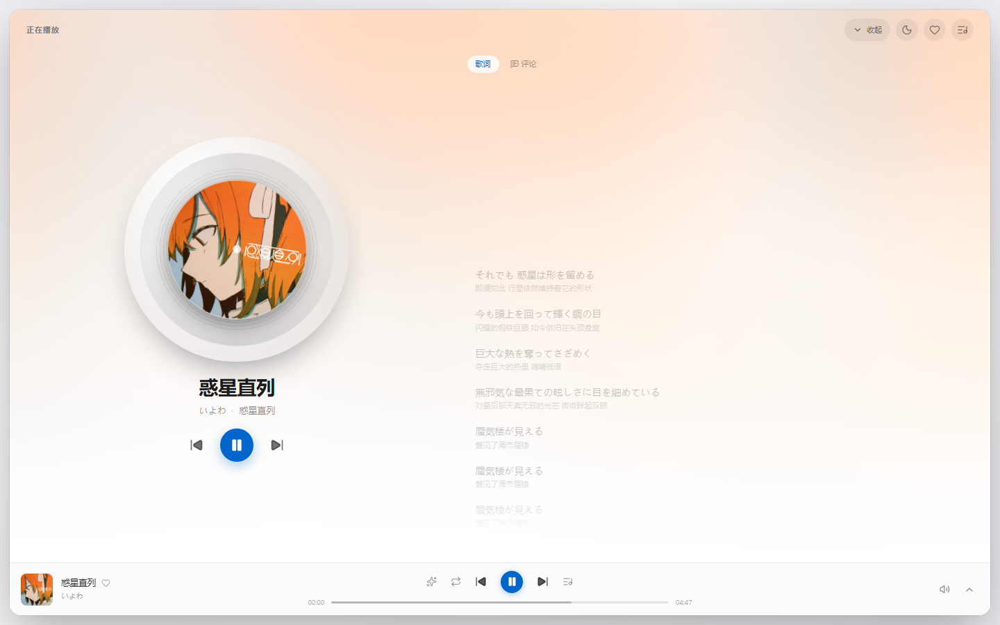
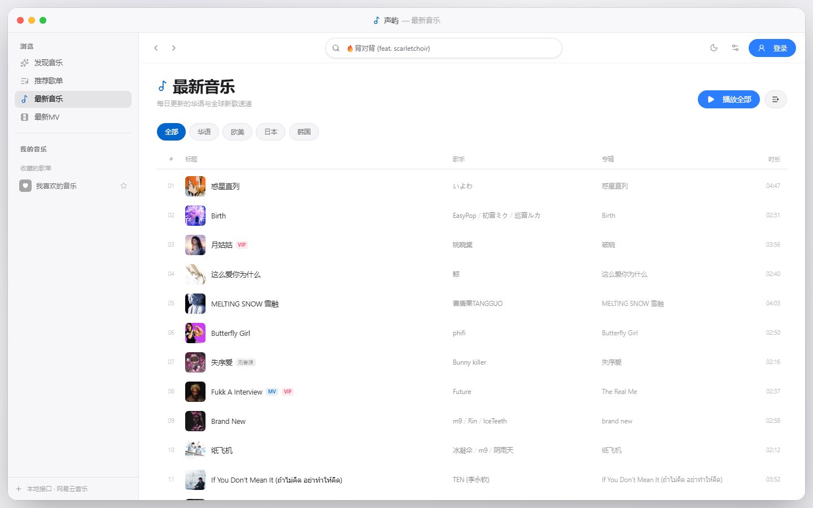
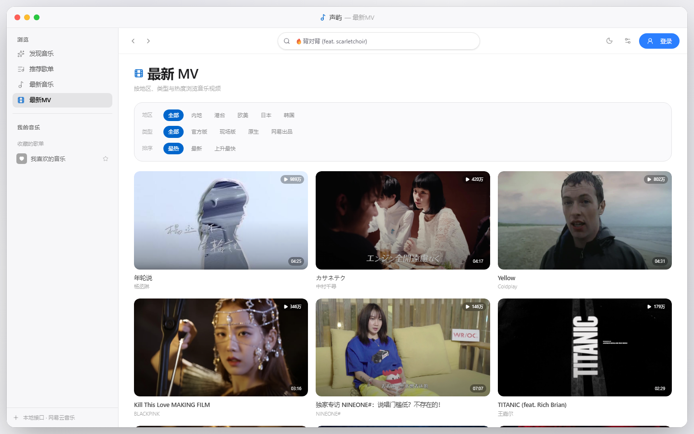
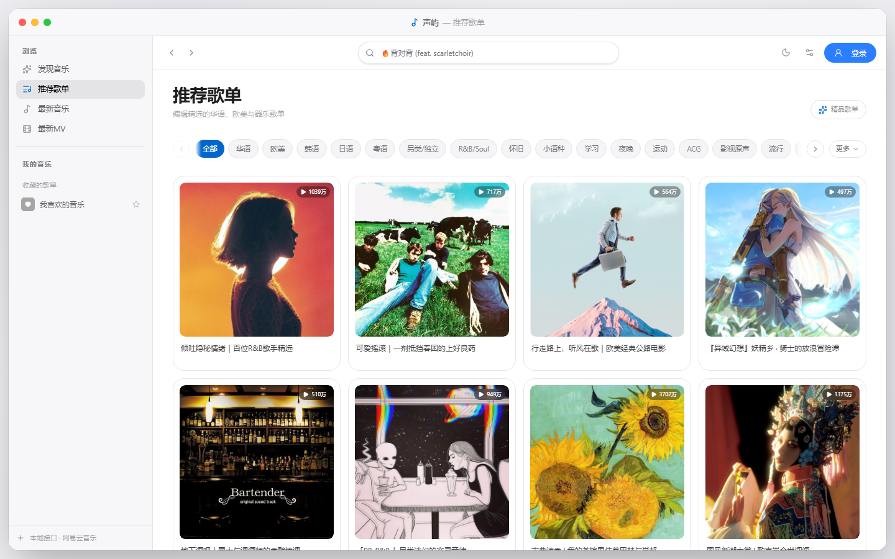
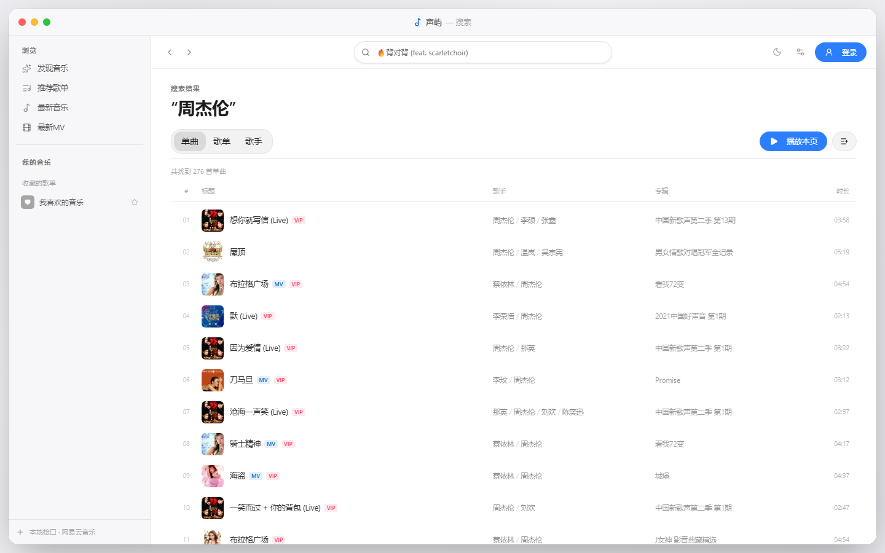
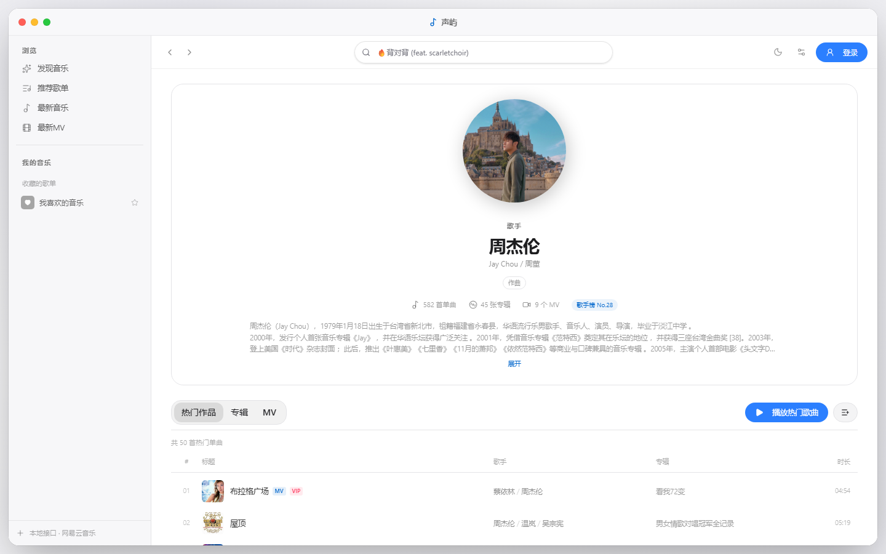
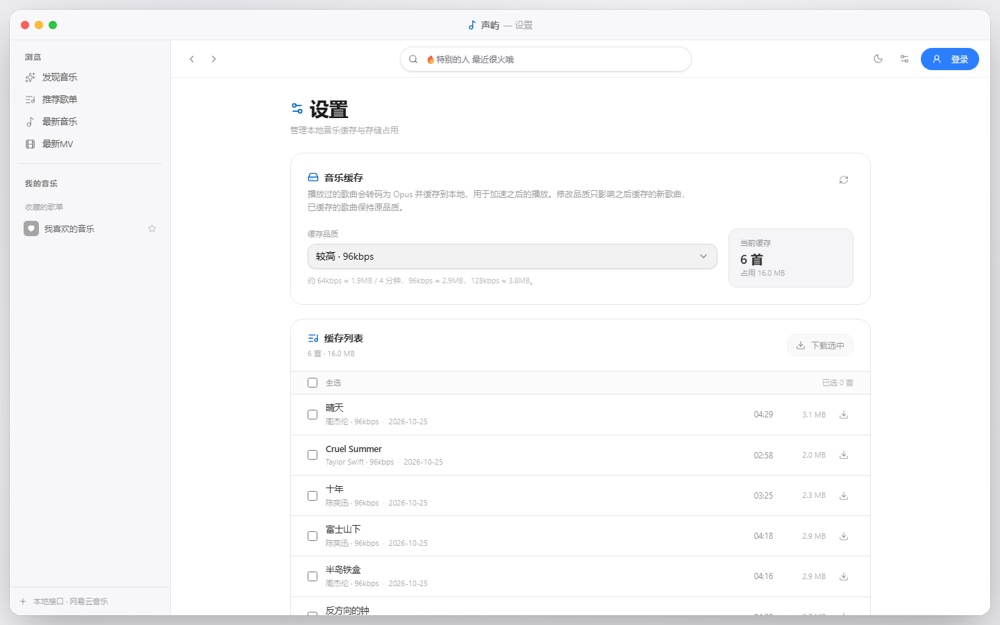

# Shengyu (声屿)

**English** | [简体中文](README.zh-CN.md)

A macOS-style third-party NetEase Cloud Music client rewritten with React 19 + TypeScript, running both in the browser and as a Windows desktop app (Electrobun).

> For learning and personal use only. All music copyrights belong to NetEase Cloud Music and the respective rights holders. Do not use commercially.

## Screenshots

| Discover | Immersive player |
| --- | --- |
|  |  |

| New music | New MVs |
| --- | --- |
|  |  |

| Playlists | Search |
| --- | --- |
|  |  |

| Artist | Settings & cache |
| --- | --- |
|  |  |

## Features

### Browse & search

- Home carousel, recommended playlists, daily mix, new MVs
- Playlist category filters, featured playlists, pagination
- New music / new MV filters by region, type and order
- Search songs, playlists, artists, MVs and videos with keyboard navigation and Enter to open
- Playlist, artist, album and MV detail pages, plus video playback

### Playback

- Standard / higher / ex-high / lossless / Hi-Res quality switching
- Next-track URL prefetch to reduce switching latency
- Queue: sequential / shuffle / repeat-one, clear queue, current-track highlight
- Volume control with persistence
- Heartbeat mode powered by NetEase recommendations
- Manual VIP source switching; optional automatic replacement in Settings
- Playback position is preserved when switching sources

### Lyrics & player

- Word-by-word (YRC) gradient highlighting, falling back to plain LRC
- Immersive player with spinning CD, album-color gradient background and lyrics/comments tabs
- Desktop lyrics window and mini player window
- Lyrics load automatically after a refresh, without pressing play first

### Account

- Phone verification-code sign-in and QR sign-in
- Login cookie persisted locally; expired sessions refresh via `/login/refresh`
- Guest cookie when signed out
- Playlists, liked songs and profile sync after sign-in

### Local cache

- Played tracks are transcoded to Ogg/Opus with WebCodecs (mediabunny)
- Cache stored in IndexedDB and preferred during playback
- 64 / 96 / 128 kbps options
- Cache list, single/batch download, one-click clear
- Multi-select downloads as ZIP on the web, `.opus` files on desktop
- Desktop cache failures are reported in the toast and `startup.log`

### UI & i18n

- Light / dark themes, following the system or set manually
- Hidden scrollbars, Apple-style motion, route fade-in
- Chinese / English switching with Lingui, persisted and applied instantly
- Accessibility: reduced motion, Esc to close, larger touch targets, toast announcements, keyboard-friendly suggestions

### Desktop

- Electrobun native window with custom title bar and window controls
- Tray resident, desktop lyrics, mini player
- Local API runs in a separate Bun child process; the installer does not require Node.js
- Optional blocking of context menu / F12 / DevTools
- Window stays hidden until the first frame to avoid a white flash

## Tech stack

| Layer | Technology |
| --- | --- |
| Renderer | React 19, TypeScript, Vite 8, TanStack Router |
| UI | Tailwind CSS v4, [@pikoloo/darwin-ui](https://www.npmjs.com/package/@pikoloo/darwin-ui), lucide-react |
| State | Zustand (player / user / ui / settings) |
| Lists | TanStack Virtual |
| i18n | Lingui 6 (`@lingui/core`, `@lingui/react`, `@lingui/vite-plugin`, `@lingui/cli`) |
| Fonts | SF Pro / PingFang SC on macOS; bundled Inter + Noto Sans SC on Windows |
| Audio cache | WebCodecs + mediabunny + IndexedDB |
| Backend | NetEaseCloudMusicApiEnhanced (`server/`) |
| Desktop | Electrobun + Hutch + Bun |
| Tests | Vitest (63 unit tests) |

## Architecture

```text
┌────────────────────────────── Desktop ─────────────────────────────┐
│  launcher (bin/launcher.exe)                                       │
│    └─ Bun main process  Resources/app/bun/index.js                 │
│         ├─ BrowserWindow (WebView2)                                │
│         │    └─ Renderer: views:// or Vite dev URL                 │
│         ├─ Bridge HTTP 127.0.0.1:13002 (window / lyrics / download)│
│         └─ Child: bin/bun.exe Resources/app/bun/api.cjs            │
│              └─ NetEaseCloudMusicApiEnhanced 127.0.0.1:13000       │
└────────────────────────────────────────────────────────────────────┘
```

- **Main process** only owns the window, tray, bridge and process lifecycle; the 12 MB API bundle is no longer inlined.
- **API bundle** is built by `scripts/prepare-electrobun-api.mjs` with esbuild into a single CJS file, loaded by a Bun child process at startup.
- **Renderer** uses `VITE_API_BASE`: `/api` on the web (Vite proxy) and `http://127.0.0.1:13000` on desktop.
- The child process watches its parent and exits if the main process quits or is killed, avoiding orphaned port holders.

### Ports

| Port | Purpose |
| --- | --- |
| `3000` | Local API during web development (`node server/app.js`) |
| `5173` | Vite dev server |
| `4173` | Default `vite preview` port |
| `13000` | Desktop API child process |
| `13002` | Desktop bridge (window control, downloads, lyrics, diagnostics) |

## Requirements

- **Node.js 22+** and **pnpm** for web development, builds and tests
- Network access to NetEase Cloud Music endpoints
- Desktop builds additionally require:
  - [Hutch CLI](https://hutch.blackboard.sh/) on `PATH`
  - Windows 10/11 with **WebView2 Runtime** (usually preinstalled)
  - Optional: Inno Setup 6, only for the custom install-directory installer

Hutch is not an npm dependency; install it separately:

```powershell
& ([scriptblock]::Create((irm https://hutch.blackboard.sh/hutch/install.ps1)))
```

Reopen the terminal after installation, then run `hutch --version`. If it is still missing, use the full path:

```powershell
& "$env:USERPROFILE\.hutch\bin\hutch.exe" run build
```

## Quick start (web)

```bash
pnpm install

# Terminal 1: local API, http://localhost:3000 by default
pnpm dev:api

# Terminal 2: frontend, http://localhost:5173 by default
pnpm dev
```

Vite proxies `/api` to `API_TARGET` (default `http://127.0.0.1:3000`). Override with environment variables:

```powershell
$env:API_TARGET="http://127.0.0.1:3000"
$env:PORT="3000"
pnpm dev:api
```

> The dev API is optimized for startup: anonymous token/key refresh runs in the background, version checks are disabled, and it is usually ready in 1–2 seconds.

## Desktop

The desktop app is powered by Electrobun. During the build, `server/` is bundled into a single file and started as a **separate child process** by the bundled Bun runtime (`Resources/bin/bun.exe`). The installer **does not require Node.js** and does not need `dev:api` running separately.

```bash
# Development mode (Hutch CLI must be on PATH)
pnpm desktop:dev

# Build the Windows installer
pnpm desktop:build

# Optional: installer with a user-selectable install directory (Inno Setup 6)
pnpm desktop:installer
```

Type-checking the desktop main process (`src/bun`) requires syncing Electrobun dependencies first:

```bash
pnpm typecheck:desktop
```

### Build artifacts

`pnpm desktop:build` writes to `build/stable-win-x64/`:

- `声屿-Setup.exe`
- `声屿-Setup.tar.zst` (must stay next to the installer)

Packaged layout:

```text
Resources/
  app/
    bun/
      index.js      main process (~300 KB)
      api.cjs       local API bundle (~12 MB, separate child process)
    views/mainview/ renderer assets
  bin/
    launcher.exe
    bun.exe
```

The installer is about **35 MB**, bundles the Bun runtime, and does not require Node.js on the target machine.

### macOS icon assets

- `assets/tray-icon-template.png` (+ `@2x`) is a monochrome template image so AppKit can tint the menu-bar icon for light/dark appearances.
- `assets/app-icon-layers/` splits the squircle background and the note into separate layers for macOS 26 Icon Composer. The final `.icon` bundle must be assembled with Apple's Icon Composer on macOS.
- `pnpm icons:generate` regenerates PNG, ICO, ICNS, tray and favicon assets from the same 1024px source.

Application data directory:

```text
%LOCALAPPDATA%\com.qimiao.music\
  startup.log    startup and renderer diagnostics
  devtools.json  DevTools policy
  instance.lock  single-instance lock
```

### Custom install directory (Inno Setup)

Electrobun's built-in `Setup.exe` is a per-user self-extracting installer: it always installs to `%LOCALAPPDATA%\Programs\声屿`, shows only a progress dialog, and **offers no directory page or command-line override**. To let users choose a directory, wrap it with Inno Setup:

```bash
# 1) Install Inno Setup 6 once
winget install --id JRSoftware.InnoSetup -e

# 2) Produce build/stable-win-x64/声屿/ first, then build the custom installer
pnpm desktop:release
```

The output is `build/installer/声屿-Setup-Custom.exe`. See `scripts/installer/app.iss` and `scripts/installer/build.mjs` (it looks for `ISCC.exe` via the `ISCC` env var, `PATH`, `%LOCALAPPDATA%\Programs\Inno Setup 6`, and `Program Files`, and prints the install command if not found):

- Includes a destination-directory page (`DisableDirPage=no`)
- Defaults to `%LOCALAPPDATA%\Programs\声屿` (no admin), with an all-users option under `Program Files`
- Extracts `声屿-Setup.tar.zst` with `tar` first, then installs the unpacked app image (`bin/` + `Resources/app`, `main.js`, `version.json`, etc.), identical to Electrobun's own layout
- Creates Start Menu entries, an optional desktop shortcut and an uninstaller

Note: do not install `Setup.exe` and `Setup-Custom.exe` for the same version side by side; each registers its own uninstall entry.

Web builds use `dist/`; desktop builds use `dist-electrobun/`.

## Internationalization (Lingui)

- Source locale: Simplified Chinese; target: English
- Config: `lingui.config.ts`
- Runtime: `src/i18n.ts` (loads catalogs, `activateLocale`, syncs `<html lang>`)
- Provider: `<I18nProvider i18n={i18n}>` in `main.tsx`
- Locale state: `locale` in `src/store/settings.ts`, persisted under `react-music-settings`
- Language entry: Settings → 语言 / Language

### Adding or changing copy

```tsx
import { Trans } from '@lingui/react/macro'

<Trans>推荐歌单</Trans>
```

For string constants or stores, use `msg`:

```ts
import { msg } from '@lingui/core/macro'
import { i18n } from '../i18n'

toast.info(i18n._(msg`已切换到其他音源`))
```

Then:

```bash
pnpm i18n:extract
```

Fill in the English in `src/locales/en.po`, and optionally run `pnpm i18n:compile` (the Vite plugin also handles catalogs automatically).

The catalog currently has **271 messages with 0 missing English translations**. Covered areas include navigation, player, queue, search, home, playlist/album/artist details, login dialog, comments, settings, new music and new MVs.

Not yet covered: profile, playlist editor, MV/video detail pages, and a few `aria-label` / `title` attributes.

## Audio cache

- Database: IndexedDB `react-music-audio`
- Format: Ogg/Opus, transcoded with WebCodecs (mediabunny)
- Defaults to 96 kbps; change it in Settings → Cache quality (affects only new entries)
- Playback quality and cache quality are independent
- Limits: 60 tracks / 80 MB; oldest entries are evicted first
- The cache list supports multi-select downloads and clearing; ZIP on the web, `.opus` files on desktop
- Third-party unblocked sources are never cached (the `/audio/proxy` endpoint only allows NetEase CDN hosts)

If "音频缓存暂不可用" appears, the toast includes the reason and the desktop app logs it to:

```text
%LOCALAPPDATA%\com.qimiao.music\startup.log
```

Common causes: WebCodecs unavailable, audio decode failure, IndexedDB quota exhaustion, or an audio proxy request failure.

## Settings

| Setting | Description |
| --- | --- |
| Language | Simplified Chinese / English, applied immediately |
| Cache quality | 64 / 96 / 128 kbps, affecting only future cache entries |
| Download folder | Desktop cache export directory |
| Auto-replace VIP sources | Prefer matched sources for VIP tracks |
| Disable DevTools | Blocks context menu / F12 / Ctrl+Shift+I; WebView2 layer applies after restart |

## Keyboard shortcuts

| Shortcut | Action |
| --- | --- |
| `Space` | Play / pause |
| `Alt` + `↑ / ↓` | Volume +5 / -5 |
| `Shift` + `Alt` + `↑ / ↓` | Volume +1 / -1 |
| `↑ / ↓` + `Enter` | Select and open a search suggestion |
| `Esc` | Close the player, queue, sidebar or search suggestions |
| `Ctrl / ⌘` + `Shift` + `L` | Show / hide desktop lyrics |

## Project structure

```text
src/
  api/           NetEase API wrappers
  bun/           Electrobun main process (window, tray, bridge, API child)
  components/    Layout, player, song lists, comments, cards, shared UI
  routes/        TanStack file routes
  store/         Zustand stores (player / user / ui / settings)
  lib/           HTTP, session, player helpers, audio cache, lyrics, formatting, i18n helpers
  locales/       Lingui catalogs (zh-CN.po / en.po)
  i18n.ts        Lingui runtime and locale switching
  styles.css     Tailwind + global styles
server/          NetEaseCloudMusicApiEnhanced local API
scripts/          Desktop API bundling, installers, first-paint measurement
assets/           Icons and README screenshots
lingui.config.ts  Lingui configuration
electrobun.config.ts / hutch.config.ts  Desktop build configuration
```

## Commands

| Command | Description |
| --- | --- |
| `pnpm dev` | Start the Vite dev server |
| `pnpm dev:api` | Start the local NetEase API |
| `pnpm build` | Build web assets into `dist/` |
| `pnpm preview` | Preview the web build |
| `pnpm typecheck` | Type-check the renderer |
| `pnpm typecheck:desktop` | Type-check the desktop main process |
| `pnpm lint` | ESLint |
| `pnpm test` | Run Vitest |
| `pnpm test:watch` | Vitest in watch mode |
| `pnpm i18n:extract` | Scan messages and update `.po` files |
| `pnpm i18n:compile` | Compile Lingui catalogs |
| `pnpm desktop:dev` | Start the Electrobun dev app |
| `pnpm desktop:build` | Build the Electrobun installer |
| `pnpm desktop:installer` | Build the custom-directory installer with Inno Setup |
| `pnpm desktop:release` | Build plus the custom-directory installer |
| `pnpm generate-routes` | Regenerate the TanStack route tree |
| `pnpm icons:generate` | Regenerate App Icon PNG/ICO/ICNS from the 1024px SVG |

## First-paint measurement

`scripts/measure-fpp.mjs` measures a production build with the system Chrome / Edge:

```bash
pnpm build
pnpm dev:api                 # terminal 1
pnpm preview --port 4173     # terminal 2

node scripts/measure-fpp.mjs --runs 5
node scripts/measure-fpp.mjs --desktop
```

It reports:

- `shell`: time until React mounts `<main>`
- `content`: time until the first real cover appears
- `FCP / LCP / DCL / load`
- `js KB` and the longest main-thread task

`--desktop` reads the desktop startup markers from:

```text
%LOCALAPPDATA%\com.qimiao.music\startup.log
```

Including `window-created`, `api-child-spawned`, `api-ready`, `renderer-first-paint` and `window-shown`.

## Environment variables

| Variable | Description |
| --- | --- |
| `VITE_API_BASE` | Renderer API base: `/api` on web, `http://127.0.0.1:13000` on desktop |
| `VITE_DESKTOP` | Enables desktop mode (hash routing, native window) |
| `API_TARGET` | Vite proxy target, default `http://127.0.0.1:3000` |
| `PORT` | Local API port, default `3000` |
| `QIMIAO_DEV_URL` | Overrides the renderer URL in desktop development (Hutch points it at Vite) |
| `QIMIAO_API_PORT` | Desktop API child port, default `13000` |
| `QIMIAO_API_HOST` | Desktop API bind host, default `127.0.0.1` |
| `PROXY_URL` / `ENABLE_PROXY` | Unblock source proxy (optional) |

## Troubleshooting

### `hutch` is not recognized

Hutch CLI is missing or not on `PATH`. Install it as described above, reopen the terminal, or use the full path:

```powershell
& "$env:USERPROFILE\.hutch\bin\hutch.exe" run build
```

### Stuck at `hutch: downloading bun ... toolchain`

The Bun version pinned by the Electrobun devkit downloads slowly from GitHub Releases. Route Hutch through a local proxy, or download the matching version manually to:

```text
%USERPROFILE%\.hutch\toolchains\bun\<version>\windows-x64\bun.exe
```

Then create a `.hutch-toolchain` file in the same directory containing the version number (for example `1.4.0`).

### White screen on desktop startup

The main window is revealed only after `dom-ready`, and its first frame comes from the inline boot shell in `index.html`. If it never appears, check the main-process console and `startup.log`; a 2.5-second fallback force-shows the window.

### "音频缓存暂不可用"

Check the reason in the toast, or run:

```powershell
Get-Content "$env:LOCALAPPDATA\com.qimiao.music\startup.log" -Tail 20
```

### All desktop API calls fail

Make sure `Resources/app/bun/api.cjs` and `Resources/bin/bun.exe` exist, and that port `13000` is free. The child process watches its parent and exits cleanly, so normal quits should not leave orphans.

## Credits

- NetEase Cloud Music API: [NetEaseCloudMusicApiEnhanced](https://github.com/neteasecloudmusicapienhanced/api)
- Unblocking references: [UnblockNeteaseMusic](https://github.com/UnblockNeteaseMusic/server)
- Desktop framework: [Electrobun](https://github.com/blackboardsh/electrobun)
- UI components: [darwin-ui](https://www.npmjs.com/package/@pikoloo/darwin-ui)
- Audio muxing: [mediabunny](https://mediabunny.dev)
- Fonts: [Inter](https://rsms.me/inter/) and [Noto Sans SC](https://fonts.google.com/noto/specimen/Noto+Sans+SC), both under the SIL Open Font License. macOS uses the system SF Pro / PingFang SC when available.

This project is for learning and personal use only. All music copyrights belong to NetEase Cloud Music and the respective rights holders.
