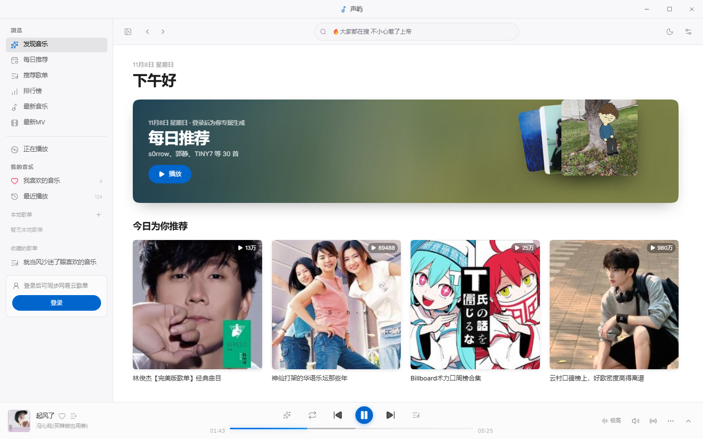
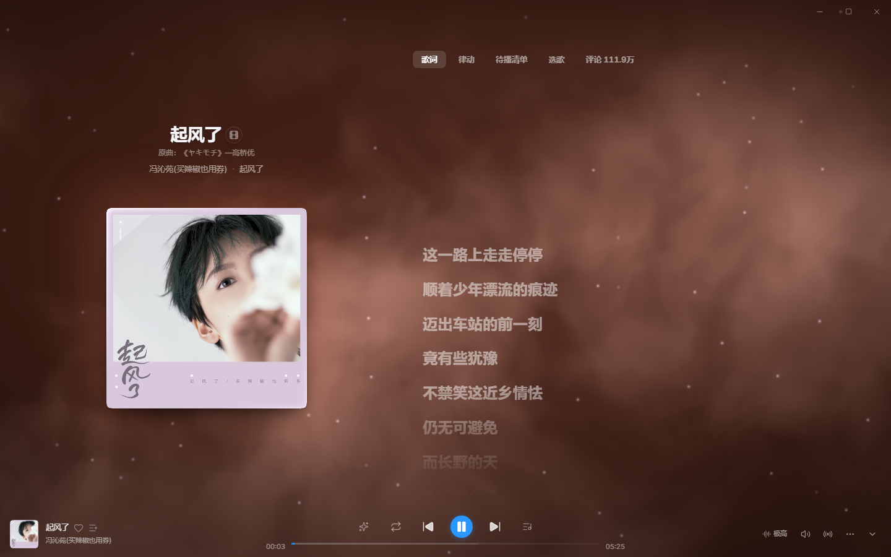
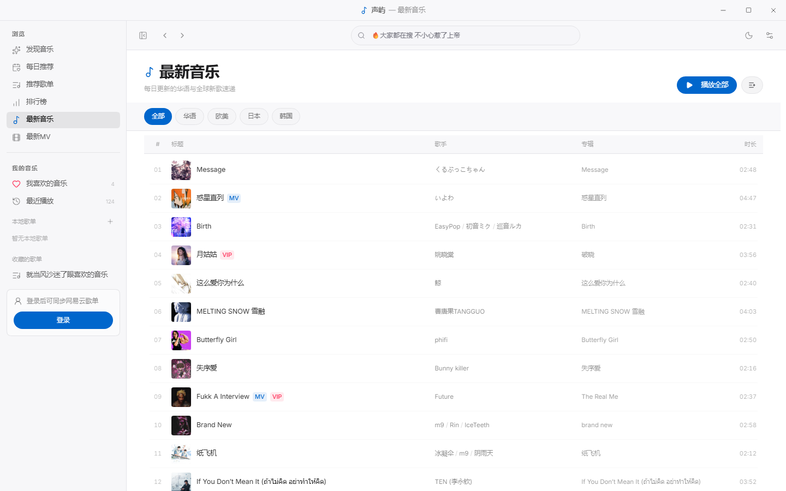
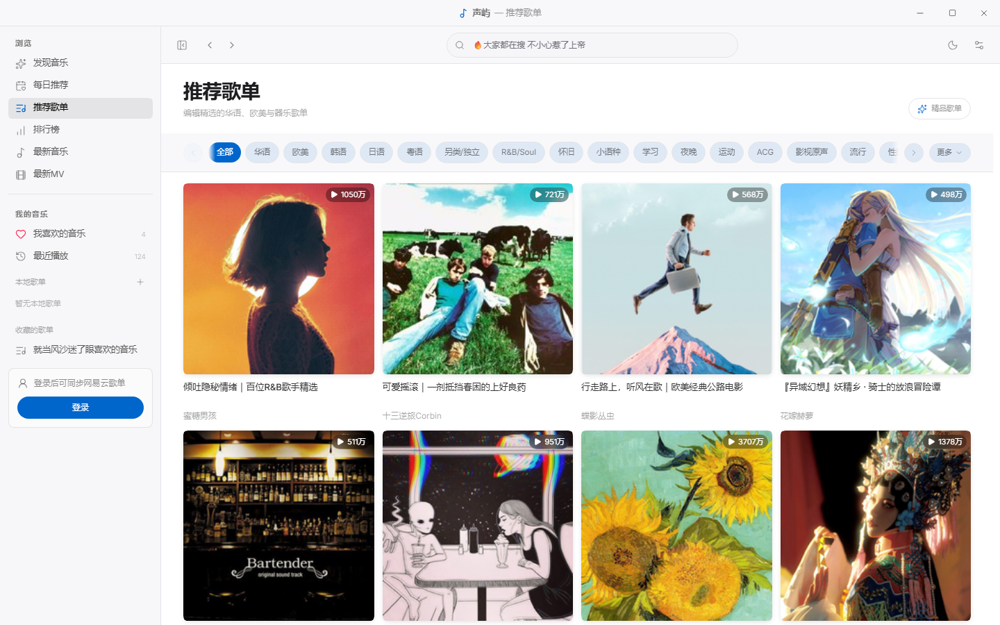
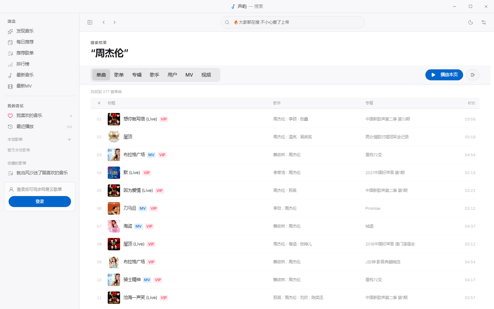
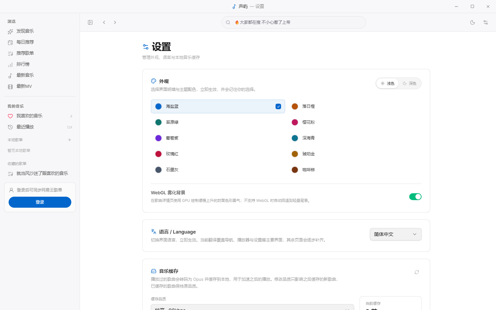
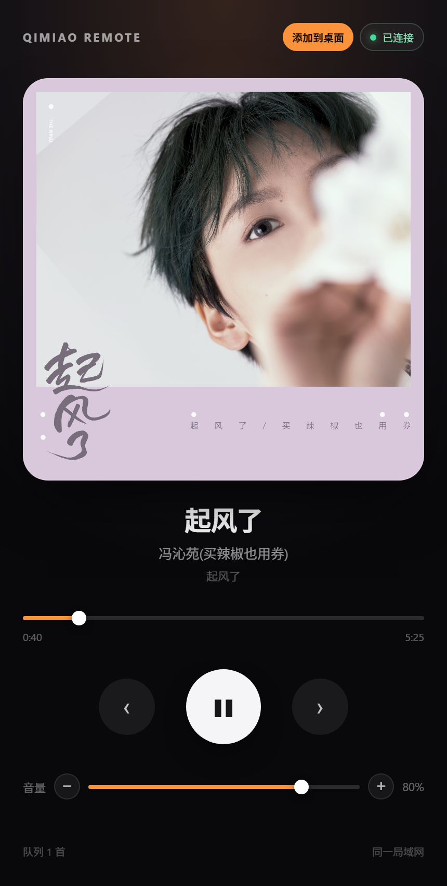

# 声屿

[English](README.md) | **简体中文**

一个 macOS 风格的网易云音乐第三方客户端，使用 React 19 + TypeScript 重写，支持 Web 与 Windows 桌面端（Electrobun）。

> 仅用于学习与个人使用，音乐版权归网易云音乐及版权方所有，请勿用于商业用途。

## 目录

- [应用截图](#应用截图)
- [功能](#功能)
- [技术栈](#技术栈)
- [架构](#架构)
- [环境要求](#环境要求)
- [快速开始（Web）](#快速开始web)
- [桌面端](#桌面端)
- [构建、发布与更新](#构建发布与更新)
- [手机遥控与 PWA](#手机遥控与-pwa)
- [国际化（Lingui）](#国际化lingui)
- [音频缓存](#音频缓存)
- [设置项](#设置项)
- [快捷键](#快捷键)
- [项目结构](#项目结构)
- [常用命令](#常用命令)
- [首屏性能测量](#首屏性能测量)
- [环境变量](#环境变量)
- [常见问题](#常见问题)
- [版权与致谢](#版权与致谢)

## 应用截图

| 发现音乐 | 全屏播放 |
| --- | --- |
|  |  |

| 最新音乐 | 最新 MV |
| --- | --- |
|  |  |

| 推荐歌单 | 搜索结果 |
| --- | --- |
|  |  |

| 歌手详情 | 设置与缓存管理 |
| --- | --- |
|  |  |

| 手机遥控 / PWA |
| :---: |
|  |

> 截图来自当前开发版本；实际界面会随主题、字号、窗口宽度和歌曲封面而变化。

## 功能

### 浏览与搜索

- 首页轮播、推荐歌单、每日推荐、最新 MV
- 推荐歌单分类筛选、精品歌单、分页加载
- 最新音乐 / 最新 MV 的地区、类型、排序筛选与分页
- 单曲 / 歌单 / 歌手 / MV / 视频搜索，支持键盘上下选择与回车进入
- 歌单详情、歌手详情、专辑详情、MV 详情与视频播放

### 播放

- 标准 / 较高 / 极高音质切换
- 自动预取下一首音频，并在切歌或自然播完前进行 320ms 双播放器交叉淡化
- 播放队列：顺序 / 随机 / 单曲循环、清空队列、当前曲目高亮
- 音量控制与持久化
- 心动模式（基于网易云智能推荐）
- VIP 歌曲手动切换其他音源；可在设置中开启「自动替换 VIP 音源」
- 切源时保留当前播放进度

### 歌词与播放页

- 逐字歌词（YRC）渐变高亮，无逐字数据时回退普通 LRC
- 沉浸播放页：透明标题栏、透明播放条、封面主题渐变、CD 唱片
- 律动模式：流光、云阶、倾诉三种逐字舞台，长句自动换行且避免字/行重叠
- 待播清单：虚拟列表、搜索、悬停显示拖拽图标排序、当前曲目高亮、定位当前播放和右键菜单
- 歌词 / 律动 / 待播清单 / 歌曲墙 / 评论标签切换
- 顶部沉浸式进度线：贴边、无侧边距、随封面色渐变，Hover 增高并显示圆点
- 桌面歌词窗口、迷你播放器窗口
- 歌词在刷新后自动加载，无需先点播放

### 账号

- 手机验证码登录、扫码登录
- 登录 Cookie 本地持久化，过期自动调用 `/login/refresh`
- 未登录时使用游客 Cookie
- 登录后同步歌单、喜欢的音乐、个人资料

### 本地缓存

- WebCodecs（mediabunny）将播放过的歌曲转码为 Ogg/Opus
- 缓存写入 IndexedDB，播放时优先读取
- 64 / 96 / 128kbps 可选
- 缓存列表、单曲 / 批量下载、一键清除
- 网页端多选下载打包为 ZIP，桌面端直接保存 `.opus`
- 桌面端缓存失败时会在 Toast 和 `startup.log` 中记录具体原因

### 界面与国际化

- 浅色 / 深色模式，跟随系统或手动切换
- 隐藏式滚动条、Apple 风格动效、路由淡入
- 中英文切换（Lingui），语言随设置持久化，立即生效
- 无障碍：减弱动效、Esc 关闭、触控热区、Toast 播报、键盘可操作搜索建议

### 桌面端

- Electrobun 原生窗口，自定义标题栏与窗口控制
- 托盘常驻、桌面歌词、迷你播放器
- 本地 API 以独立 Bun 子进程运行，安装版无需安装 Node.js
- 打包版强制禁用右键菜单、F12、Ctrl+Shift+I/J/C 和 Ctrl+U，忽略旧 `devtools.json`
- 开发版可在设置中切换 DevTools；生产版不显示该选项
- 窗口首帧前保持隐藏，避免启动白屏

### 手机遥控与 PWA

- 桌面 API 提供 `/remote/` 手机控制页
- 播放 / 暂停、上一首 / 下一首、进度拖动、音量滑杆与 ±5% 按钮
- 当前歌曲封面、歌名、歌手、专辑、连接状态和队列数量
- 手机页面可通过 PWA Manifest 添加到主屏幕
- 手机命令和连接活动通过 Server-Sent Events 推送给桌面渲染层
- 默认只向局域网开放 `/remote`，其他 API 仍仅限本机访问

## 技术栈

| 层次 | 技术 |
| --- | --- |
| 渲染层 | React 19、TypeScript、Vite 8、TanStack Router |
| UI | Tailwind CSS v4、[@pikoloo/darwin-ui](https://www.npmjs.com/package/@pikoloo/darwin-ui)、lucide-react |
| 状态 | Zustand（player / user / ui / settings） |
| 列表 | TanStack Virtual |
| 国际化 | Lingui 6（`@lingui/core`、`@lingui/react`、`@lingui/vite-plugin`、`@lingui/cli`） |
| 字体 | macOS 使用系统 SF Pro / PingFang SC；Windows 捆绑 Inter + Noto Sans SC |
| 音频缓存 | WebCodecs + mediabunny + IndexedDB |
| 后端 | NetEaseCloudMusicApiEnhanced（`server/`） |
| 桌面端 | Electrobun + Hutch + Bun |
| 手机遥控 | Node HTTP、PWA Manifest、Service Worker |
| 测试 | Vitest（76 项单测） |

## 架构

```text
┌──────────────────────────────── 桌面端 ────────────────────────────────┐
│  launcher (bin/launcher.exe)                                          │
│    └─ Bun 主进程  Resources/app/bun/index.js                          │
│         ├─ BrowserWindow（WebView2）                                  │
│         │    └─ 渲染层：views:// 或 Vite dev URL                      │
│         ├─ Bridge HTTP 127.0.0.1:13002（窗口 / 歌词 / 下载 / 日志）    │
│         └─ 子进程：bin/bun.exe Resources/app/bun/api.cjs              │
│              ├─ NetEaseCloudMusicApiEnhanced 127.0.0.1:13000          │
│              └─ /remote/ 手机遥控页 + 命令/状态中继                   │
└───────────────────────────────────────────────────────────────────────┘

手机浏览器 ──局域网──> http://<PC-IP>:13000/remote/
                          │
                          └─ SSE 事件流 ⇄ 桌面渲染层（单条持久连接）
```

- **主进程**只负责窗口、托盘、bridge 和进程生命周期，不再内联 12 MB API bundle。
- **API bundle** 由 `scripts/prepare-electrobun-api.mjs` 用 esbuild 打包为单文件 CJS，启动时由 Bun 子进程加载。
- **渲染层**通过 `VITE_API_BASE` 访问 API：Web 端为 `/api`（Vite 代理），桌面端为 `http://127.0.0.1:13000`。
- **手机遥控**由 API 子进程提供 `/remote/` 和 `/remote/api/*`，桌面渲染层的 `useRemoteBridge()` 负责发布状态与执行命令。
- 子进程带父进程看门狗，主进程退出 / 被强杀后会自行结束，避免孤儿进程占用端口。
- 打包版 API 默认监听 `0.0.0.0`，启用 `QIMIAO_REMOTE_ONLY=1`：非本机请求只能访问 `/remote`，其他网易云接口仍返回 403。

### 端口

| 端口 | 用途 |
| --- | --- |
| `3000` | Web 开发时的本地 API（`node server/app.js`） |
| `5173` | Vite 开发服务器 |
| `4173` | `vite preview` 默认端口 |
| `13000` | 桌面端 API 子进程 |
| `13002` | 桌面端 bridge（窗口控制、下载、歌词、诊断日志） |

## 环境要求

- **Node.js 22+** 与 **pnpm**（Web 开发、构建、测试）
- 可访问网易云音乐接口
- 桌面端构建额外需要：
  - [Hutch CLI](https://hutch.blackboard.sh/)（PATH 中可用）
  - Windows 10/11 与 **WebView2 Runtime**（系统通常自带）
  - 可选：Inno Setup 6（仅自定义安装目录安装包需要）

Hutch 不是 npm 依赖，需要单独安装：

```powershell
& ([scriptblock]::Create((irm https://hutch.blackboard.sh/hutch/install.ps1)))
```

安装后**重开终端**，再执行 `hutch --version`。如果仍找不到，可使用全路径：

```powershell
& "$env:USERPROFILE\.hutch\bin\hutch.exe" run build
```

## 快速开始（Web）

```bash
pnpm install

# 终端 1：本地 API，默认 http://localhost:3000
pnpm dev:api

# 终端 2：前端，默认 http://localhost:5173
pnpm dev
```

Vite 会把 `/api` 代理到 `API_TARGET`（默认 `http://127.0.0.1:3000`）。可通过环境变量修改：

```powershell
$env:API_TARGET="http://127.0.0.1:3000"
$env:PORT="3000"
pnpm dev:api
```

> 开发 API 已做启动优化：匿名 token / key 在后台刷新，版本检查关闭，通常 1–2 秒内可用。

## 桌面端

桌面端由 Electrobun 驱动。构建时会把 `server/` 打包成单文件，由自带的 Bun 运行时（`Resources/bin/bun.exe`）以**独立子进程**启动；安装版**无需安装 Node.js**，也不需要单独启动 `dev:api`。

```bash
# 开发模式（需要 Hutch CLI 在 PATH 中）
pnpm desktop:dev

# 构建 Windows 安装包
pnpm desktop:build

# 可选：生成支持自选安装目录的安装包（需要 Inno Setup 6）
pnpm desktop:installer
```

桌面主进程（`src/bun`）的类型检查需要先同步 Electrobun 依赖，再执行：

```bash
pnpm typecheck:desktop
```

### 构建产物

`pnpm desktop:build` 产物位于 `build/stable-win-x64/`：

- `声屿-Setup.exe`
- `声屿-Setup.tar.zst`（需与安装器放在同一目录）

打包后的应用结构：

```text
Resources/
  app/
    bun/
      index.js      主进程（约 300 KB）
      api.cjs       本地 API bundle（约 12 MB，独立子进程）
    views/mainview/ 渲染层静态资源
  bin/
    launcher.exe
    bun.exe
```

安装包约 **35 MB**，自带 Bun 运行时，不要求目标机器安装 Node.js。

### 窗口与任务栏行为

- 关闭窗口只是隐藏到托盘，音乐继续播放；退出请使用托盘菜单的 **退出声屿**。
- 托盘菜单的 **重新加载界面** 是黑屏 / 界面无响应时的手动恢复入口；它会重建渲染层并中断当前播放，应用不会自动 reload。
- 系统睡眠超过 90 秒后恢复时，应用会暂停一次播放，避免直接继续播放。
- 窗口隐藏到托盘后，点击任务栏固定的应用图标会启动第二个进程，由它调用运行中实例的本地 `/activate` 接口，重新显示已有窗口。
- 如果窗口当前可见，这次激活会将其最小化；窗口最小化时再次激活则还原，因此重复点击会在最小化 / 还原之间切换。

### macOS 图标资源

- `assets/tray-icon-template.png`（含 `@2x`）是单色 template image，菜单栏图标由 AppKit 自动适配浅色 / 深色外观。
- `assets/app-icon-layers/` 将 squircle 背景与音符拆成独立图层，供 macOS 26 Icon Composer 使用；最终 `.icon` 包需要在 macOS 上用 Icon Composer 组装。
- `pnpm icons:generate` 会从同一份 1024px 源重新生成 PNG、ICO、ICNS、托盘图标和 favicon。

应用数据目录：

```text
%LOCALAPPDATA%\com.qimiao.music\
  startup.log    启动阶段与渲染层诊断日志
  devtools.json  开发者工具策略
  instance.lock  单实例锁
```

### 自定义安装目录（Inno Setup）

Electrobun 自带的 `Setup.exe` 是「每用户自解压安装器」：固定装到 `%LOCALAPPDATA%\Programs\声屿`，提示框只有安装进度，**没有安装目录选择页，也没有可用的命令行参数改路径**。需要让用户自选目录时，用 Inno Setup 再包一层：

```bash
# 1) 安装 Inno Setup 6（一次性）
winget install --id JRSoftware.InnoSetup -e

# 2) 先产出 build/stable-win-x64/声屿/，再打自定义安装器
pnpm desktop:release
```

产物为 `build/installer/声屿-Setup-Custom.exe`，脚本见 `scripts/installer/app.iss`、编译入口 `scripts/installer/build.mjs`（会依次从 `ISCC` 环境变量、PATH、`%LOCALAPPDATA%\Programs\Inno Setup 6`、`Program Files` 里找 `ISCC.exe`，找不到会提示安装命令）：

- 有「选择目标位置」页（`DisableDirPage=no`）；
- 默认装到 `%LOCALAPPDATA%\Programs\声屿`（免管理员），也可选择「为所有用户安装」装到 `Program Files`；
- 安装前会先用 `tar` 解开 `声屿-Setup.tar.zst`，安装的是解压后的应用镜像（`bin/` + `Resources/app`、`main.js`、`version.json` 等），与 Electrobun 自己装完的目录完全一致；
- 会创建开始菜单、可选桌面快捷方式和卸载项。

注：同一个版本不要同时安装 `Setup.exe` 与 `Setup-Custom.exe`，两者会各自注册卸载信息。

Web 构建使用 `dist/`，桌面端构建使用 `dist-electrobun/`，互不覆盖。

## 构建、发布与更新

推荐流程：

```powershell
# 1. 退出正在运行的开发版 / 正式版
# 2. 构建并生成自定义安装包
pnpm desktop:release

# 3. 运行生成的安装器
Start-Process .\build\installer\声屿-Setup-Custom.exe

# 4. 从开始菜单或桌面快捷方式启动正式版
```

`desktop:release` 只负责构建和生成安装包，不会自动替换正在运行的开发版，也不会自动执行安装器。

### 开发版与正式版的区别

```text
pnpm desktop:dev    → build/dev-win-x64/声屿-dev
pnpm desktop:release → build/installer/声屿-Setup-Custom.exe + build/stable-win-x64
安装器               → %LOCALAPPDATA%\Programs\声屿 或用户选择的目录
```

如果安装后仍看到旧界面，先检查当前进程路径：

```powershell
Get-CimInstance Win32_Process |
  Where-Object { $_.Name -eq 'bun.exe' } |
  Select-Object ProcessId,CommandLine
```

正式版应显示：

```text
...\Programs\声屿\bin\bun.exe ...\Resources\main.js
```

而不是：

```text
...\build\dev-win-x64\声屿-dev\bin\bun.exe
```

### 覆盖安装

当前 Inno Setup 安装器使用固定 `AppId` 和 `UsePreviousAppDir=yes`。再次运行新的 `声屿-Setup-Custom.exe` 会：

- 沿用之前选择的安装目录；
- 覆盖旧程序文件；
- 更新卸载项；
- 保留用户数据、缓存和登录状态。

安装前必须完全退出正式版、开发版和托盘进程。安装器不会自动删除新版本中已经移除的旧资源；遇到旧 CSS / JS 残留时可以卸载后重新安装。

### 构建锁

Electrobun 不允许 dev 和 release 同时写 `build/`：

```text
[electrobun] Waiting for the project build lock...
```

看到这条信息时，先停止 `pnpm desktop:dev`，并结束残留的 `hutch electrobun dev --watch`、`desktop-dev.mjs` 和 `build/dev-win-x64` 进程，再重新运行 release。锁文件位于：

```text
.hutch/locks/electrobun-build.lock
```

只有在确认没有 Electrobun 进程后，才应删除这个锁文件。

### 生产环境的 DevTools

打包版强制关闭 DevTools：

- 主进程不读取旧的 `devtools.json`，直接返回 `disabled = true`；
- Windows WebView2 启动时带 `--disable-dev-tools`；
- 渲染层屏蔽右键、F12、Ctrl+Shift+I/J/C 和 Ctrl+U；
- 设置页不显示 DevTools 开关。

开发版仍可在设置中调整开发者工具策略，方便调试。

## 手机遥控与 PWA

桌面端启动后，API 子进程会同时提供手机控制页：

```text
http://<电脑局域网 IP>:13000/remote/
```

例如：

```text
http://192.168.1.20:13000/remote/
```

要求：

- 手机和电脑在同一局域网；
- Windows 防火墙允许 Node / Bun 或 `13000` 端口通过专用网络；
- 使用当前安装的桌面 API 端口（默认 `13000`）。

### 控制能力

| 功能 | 说明 |
| --- | --- |
| 播放 / 暂停 | 与桌面播放状态同步 |
| 上一首 / 下一首 | 控制当前队列 |
| 进度 | 拖动进度条，松开后发送 seek |
| 音量 | 滑杆与 ±5% 按钮，实时显示百分比 |
| 状态 | 当前歌曲、歌手、专辑、封面、队列数量 |
| 连接状态 | 桌面 API 与渲染层是否在线 |

### PWA

页面提供：

```text
/remote/manifest.webmanifest
/remote/sw.js
/remote/icon-192.png
/remote/icon-512.png
```

支持 Android Chrome 的安装提示、iOS Safari 的「添加到主屏幕」，以及独立窗口模式。

> 局域网 HTTP 地址不属于安全上下文。部分浏览器会禁用 Service Worker 或原生安装提示；仍可通过浏览器菜单创建快捷方式。要实现完整离线 PWA，需要给遥控页配置 HTTPS。

### 安全

手机遥控目前没有配对码或登录鉴权：

- 同一局域网内知道地址的人可以控制播放；
- 不要将 `13000` 直接暴露到公网；
- 建议只在家庭或可信局域网使用。

桌面端只会向非本机客户端开放 `/remote`；其他 API 路径仍使用本机回环访问限制。

## 国际化（Lingui）

- 源语言：简体中文；目标语言：英文
- 配置：`lingui.config.ts`
- 运行时：`src/i18n.ts`（加载 catalog、`activateLocale`、同步 `<html lang>`）
- Provider：`main.tsx` 中的 `<I18nProvider i18n={i18n}>`
- 语言状态：`src/store/settings.ts` 的 `locale`，持久化在 `react-music-settings`
- 语言入口：设置 → 语言 / Language

### 添加或修改文案

```tsx
import { Trans } from '@lingui/react/macro'

<Trans>推荐歌单</Trans>
```

字符串常量或 store 内使用 `msg`：

```ts
import { msg } from '@lingui/core/macro'
import { i18n } from '../i18n'

toast.info(i18n._(msg`已切换到其他音源`))
```

然后：

```bash
pnpm i18n:extract
```

在 `src/locales/en.po` 中填写英文，再执行 `pnpm i18n:compile`（可选，Vite 插件也会自动处理）。

当前 catalog 共 **271 条，英文 Missing 0**。已覆盖导航、播放器、队列、搜索、首页、歌单 / 专辑 / 歌手详情、登录弹窗、评论、设置、最新音乐 / 最新 MV 等主要界面。

尚未覆盖：个人主页、歌单编辑页、MV / 视频详情页，以及少量 `aria-label` / `title`。

## 音频缓存

- 数据库：IndexedDB `react-music-audio`
- 格式：Ogg / Opus，由 WebCodecs（mediabunny）转码
- 默认 96kbps，可在「设置 → 缓存品质」调整；修改只影响之后缓存的新歌曲
- 播放音质与缓存品质相互独立
- 缓存上限：60 首 / 80MB，超出后按缓存时间淘汰
- 缓存列表支持多选下载、清除全部；网页端多选打包 ZIP，桌面端保存 `.opus`
- 第三方解灰音源不写入缓存（避免经过只允许网易 CDN 的 `/audio/proxy`）

如果出现「音频缓存暂不可用」，Toast 会附带具体原因；桌面端同时写入：

```text
%LOCALAPPDATA%\com.qimiao.music\startup.log
```

常见原因：WebCodecs 不可用、音频解码失败、IndexedDB 配额不足、音频代理请求失败。

## 设置项

| 设置 | 说明 |
| --- | --- |
| 语言 / Language | 简体中文 / English，立即生效 |
| 缓存品质 | 64 / 96 / 128kbps，只影响后续缓存 |
| 下载目录 | 桌面端缓存导出目录 |
| VIP 歌曲自动替换音源 | 开启后 VIP 歌曲优先尝试其他音源 |
| 听歌打卡 | 默认关闭；真实播放达到 50% 或 4 分钟后上报一次。使用第三方客户端协议，记录可能被忽略或触发风控 |
| 禁用开发者工具 | 仅开发版显示；打包版强制启用 WebView2 DevTools 禁用 |

## 快捷键

| 按键 | 功能 |
| --- | --- |
| `Space` | 播放 / 暂停；输入框、弹窗和菜单内保留原生空格 |
| `Alt` + `↑ / ↓` | 音量 +5 / -5 |
| `Shift` + `Alt` + `↑ / ↓` | 音量 +1 / -1 |
| `↑ / ↓` + `Enter` | 在搜索建议中选择并进入 |
| `Esc` | 关闭播放页、播放列表、侧栏或搜索建议 |
| `Ctrl / ⌘` + `Shift` + `L` | 显示 / 隐藏桌面歌词 |

播放条标题区域获得焦点后，`Space` 仍然控制播放；`Enter` 才会打开歌曲详情页。长按 Space 产生的重复按键会被忽略。

## 项目结构

```text
src/
  api/           NetEase API 封装
  bun/           Electrobun 主进程（窗口、托盘、bridge、API 子进程）
  components/    布局、播放器、歌曲列表、评论、卡片、通用组件
  routes/        TanStack 文件路由页面
  store/         Zustand 状态（player / user / ui / settings）
  lib/           HTTP、会话、播放器辅助、音频缓存、歌词、格式化、i18n 辅助
  locales/       Lingui catalogs（zh-CN.po / en.po）
  i18n.ts        Lingui 运行时与 locale 切换
  styles.css     Tailwind + 全局样式
server/          NetEaseCloudMusicApiEnhanced 本地 API
  remoteControl.js  /remote 页面、Manifest、Service Worker、命令中继
  remoteIcons.js    内嵌 PWA 图标
scripts/         桌面 API 打包、安装器、首屏性能测量
assets/          图标与 README 截图
lingui.config.ts Lingui 配置
electrobun.config.ts / hutch.config.ts  桌面构建配置
```

其他关键文件：

```text
src/lib/remoteBridge.ts       桌面端遥控状态发布与 SSE 命令接收
src/components/common/MenuSurface.tsx  歌曲详情页浮动菜单表面
src/components/player/PlayerMenuContent.tsx  播放条弹层适配
src/components/common/ToastBridge.tsx  Toast 渲染桥接
```

## 常用命令

| 命令 | 说明 |
| --- | --- |
| `pnpm dev` | 启动 Vite 开发服务器 |
| `pnpm dev:api` | 启动本地网易云 API |
| `pnpm build` | 构建 Web 静态资源（`dist/`） |
| `pnpm preview` | 预览 Web 构建产物 |
| `pnpm typecheck` | 渲染层 TypeScript 检查 |
| `pnpm typecheck:desktop` | 桌面主进程 TypeScript 检查 |
| `pnpm lint` | ESLint |
| `pnpm test` | Vitest 单测 |
| `pnpm test:watch` | Vitest watch |
| `pnpm i18n:extract` | 扫描文案并更新 `.po` |
| `pnpm i18n:compile` | 编译 Lingui catalog |
| `pnpm desktop:dev` | 启动 Electrobun 开发版 |
| `pnpm desktop:build` | 构建 Electrobun 安装包 |
| `pnpm desktop:installer` | 用 Inno Setup 生成支持自选目录的安装包 |
| `pnpm desktop:release` | 构建 + 生成自定义目录安装包 |
| `pnpm generate-routes` | 重新生成 TanStack 路由树 |
| `pnpm icons:generate` | 从 1024px SVG 重新生成 App Icon 的 PNG / ICO / ICNS |

## 首屏性能测量

仓库提供 `scripts/measure-fpp.mjs`，使用系统 Chrome / Edge 测量生产构建的首屏：

```bash
pnpm build
pnpm dev:api                 # 终端 1
pnpm preview --port 4173     # 终端 2

node scripts/measure-fpp.mjs --runs 5
node scripts/measure-fpp.mjs --desktop
```

输出包括：

- `shell`：React 挂载出 `<main>` 的时间
- `content`：首屏第一张真实封面出现的时间
- `FCP / LCP / DCL / load`
- `js KB`、最长主线程任务

`--desktop` 读取桌面端启动标记：

```text
%LOCALAPPDATA%\com.qimiao.music\startup.log
```

包含 `window-created`、`api-child-spawned`、`api-ready`、`renderer-first-paint`、`window-shown`。

## 环境变量

| 变量 | 说明 |
| --- | --- |
| `VITE_API_BASE` | 前端 API 地址：Web 默认 `/api`，桌面端 `http://127.0.0.1:13000` |
| `VITE_DESKTOP` | 是否启用桌面端模式（Hash 路由、原生窗口） |
| `API_TARGET` | Vite 代理目标，默认 `http://127.0.0.1:3000` |
| `PORT` | 本地 API 端口，默认 `3000` |
| `QIMIAO_DEV_URL` | 桌面开发时覆盖渲染层地址（默认由 Hutch 指向 Vite） |
| `QIMIAO_API_PORT` | 桌面 API 子进程端口，默认 `13000` |
| `QIMIAO_API_HOST` | 桌面 API 绑定地址；打包版默认 `0.0.0.0`，便于手机访问 |
| `QIMIAO_REMOTE_ONLY` | `1` 时非本机客户端只能访问 `/remote`，其他 API 返回 403 |
| `PROXY_URL` / `ENABLE_PROXY` | 解灰音源代理（可选） |

## 常见问题

### `hutch` 不是内部或外部命令

Hutch CLI 未安装或未进入 PATH。按上文安装后重开终端，或使用全路径：

```powershell
& "$env:USERPROFILE\.hutch\bin\hutch.exe" run build
```

### 卡在 `hutch: downloading bun ... toolchain`

Electrobun devkit 固定的 Bun 版本下载较慢（GitHub Release）。可让 Hutch 走本机代理，或手动下载对应版本放到：

```text
%USERPROFILE%\.hutch\toolchains\bun\<version>\windows-x64\bun.exe
```

并在同目录创建 `.hutch-toolchain` 文件，内容为版本号（如 `1.4.0`）。

### 主进程改动需要重启 desktop:dev

`pnpm desktop:dev` 只热更新渲染层；修改 `src/bun/`、`assets/*.ps1` 或 `electrobun.config.ts` 后，需要停止并重新运行 dev 进程，否则仍在执行旧的主进程。

### 桌面端启动白屏

主窗口在 `dom-ready` 后才显示，首帧来自 `index.html` 内联启动骨架。如果长时间不出现，检查主进程控制台与 `startup.log`；2.5 秒兜底会强制显示窗口。

### 缓存提示「音频缓存暂不可用」

查看 Toast 附带的错误原因，或：

```powershell
Get-Content "$env:LOCALAPPDATA\com.qimiao.music\startup.log" -Tail 20
```

### 桌面端接口全部失败

确认 `Resources/app/bun/api.cjs` 与 `Resources/bin/bun.exe` 存在，并检查端口 `13000` 是否被占用。应用会带父进程看门狗，正常退出不会留下孤儿进程。

### 卡在 `Waiting for the project build lock...`

说明还有 Electrobun dev / build 进程在运行。先退出：

```powershell
Get-CimInstance Win32_Process |
  Where-Object {
    $_.CommandLine -match 'desktop:dev|hutch.*run dev|electrobun dev|desktop-dev\.mjs|dev-win-x64.*bun\.exe'
  } |
  ForEach-Object { Stop-Process -Id $_.ProcessId -Force }
```

确认进程退出后再重新运行 `pnpm desktop:release`。不要只删除 `.hutch/locks/electrobun-build.lock` 而不结束占用进程。

### Release 后前台界面没变化

`pnpm desktop:release` 只生成安装包：

```text
build/installer/声屿-Setup-Custom.exe
```

需要关闭旧应用，运行安装器，再从正式版快捷方式启动。若前台进程仍指向：

```text
build\dev-win-x64\声屿-dev\bin\bun.exe
```

说明看到的是开发版，而不是刚安装的正式版。

### 手机打不开 `/remote`

按顺序检查：

1. 电脑和手机是否在同一局域网；
2. 使用的 IP 是否为电脑当前局域网 IP；
3. Windows 防火墙是否允许 `13000` 端口；
4. 桌面 API 是否已重启（旧进程可能仍绑定 `127.0.0.1`）；
5. 手机上访问的是否是 `/remote/`（建议带结尾斜杠）。

非本机访问其他 API 返回 `403` 是预期行为，不是故障。

### 标题栏 / 播放条背景没有变成沉浸式渐变

确认当前运行的是最新构建，并完全退出旧版进程。歌曲详情页的标题栏和播放条由状态驱动透明化；开发版和打包版需要使用同一次构建产物。重新执行 release、安装器并启动正式版即可。

## 版权与致谢

- 网易云音乐 API：[NetEaseCloudMusicApiEnhanced](https://github.com/neteasecloudmusicapienhanced/api)
- 解灰参考：[UnblockNeteaseMusic](https://github.com/UnblockNeteaseMusic/server)
- 桌面框架：[Electrobun](https://github.com/blackboardsh/electrobun)
- UI 组件：[darwin-ui](https://www.npmjs.com/package/@pikoloo/darwin-ui)
- 音频封装：[mediabunny](https://mediabunny.dev)
- 字体：[Inter](https://rsms.me/inter/) 与 [Noto Sans SC](https://fonts.google.com/noto/specimen/Noto+Sans+SC)，均使用 SIL Open Font License；macOS 会优先使用系统 SF Pro / PingFang SC。

本项目仅用于学习与个人使用，所有音乐版权归网易云音乐及版权方所有。
